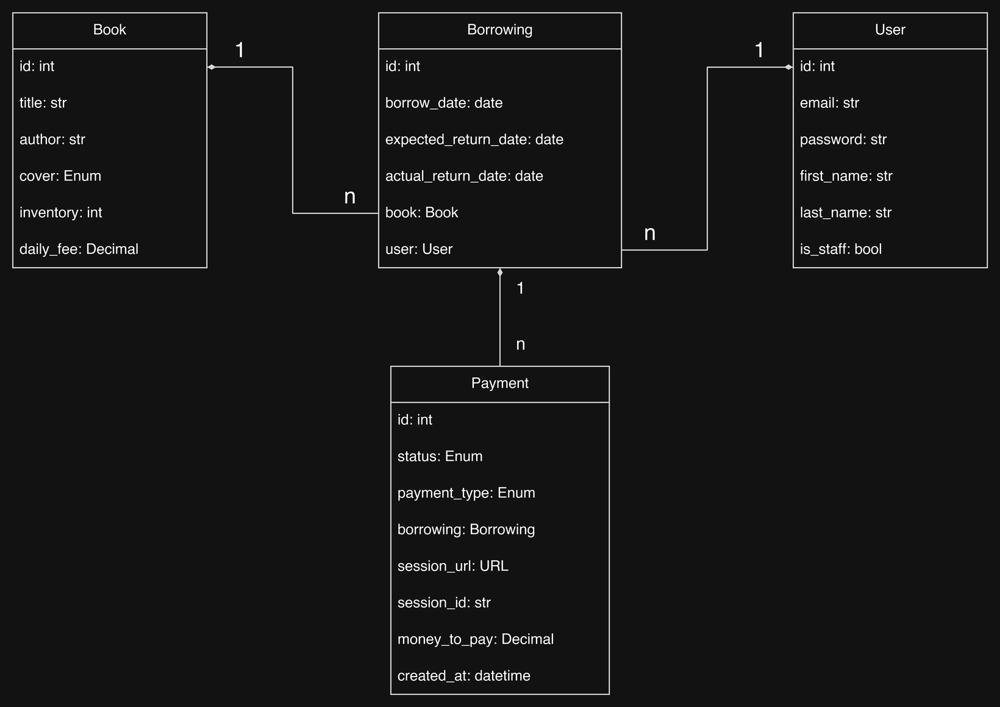

# Library Service API

Book borrowing service for a library: books with inventory, borrowings paid through Stripe,
fines for late returns and Telegram notifications for admins.

## Features

* JWT authentication with the `Authorize` header
* Anyone can browse books, only admins can add, edit and delete them
* Borrowing a book takes one copy and creates a Stripe Checkout session for the whole period
* A late return creates a FINE payment: overdue days × daily fee × 2
* Stripe `success` and `cancel` endpoints: a payment becomes paid only after Stripe confirms it
* If Stripe is unavailable, the borrowing or the return is rolled back with 503
* Users see only their own borrowings and payments, admins see all of them
* Telegram notifications about new borrowings and a daily overdue report at 08:00 Kyiv time
* Swagger documentation at `/api/doc/swagger/`

## Tech stack

Python 3.12, Django 6.0, Django REST Framework, Simple JWT, PostgreSQL 15, Celery, Redis,
Stripe, Telegram Bot API, drf-spectacular, Docker Compose, coverage.py

## Running with Docker

```shell
git clone https://github.com/rinotokun/library-service-project.git
cd library-service-project
cp .env.sample .env
```

Fill in the values in angle brackets and put your Telegram chat id into `GROUP_ID`. Then start
the project:

```shell
docker compose up --build
```

Create an admin account in another terminal:

```shell
docker compose exec app python manage.py createsuperuser
```

The API is available at `http://127.0.0.1:8000/`.

## Environment variables

| Variable | Description |
|---|---|
| `BOT_TOKEN` | Telegram bot token |
| `GROUP_ID` | Telegram chat id for admin notifications |
| `DJANGO_SECRET_KEY` | Django secret key |
| `DJANGO_SETTINGS_MODULE` | `config.settings.dev` or `config.settings.prod` |
| `DJANGO_ALLOWED_HOSTS` | Comma-separated hosts for prod |
| `POSTGRES_HOST`, `POSTGRES_DB_PORT` | Database host and port |
| `POSTGRES_DB`, `POSTGRES_USER`, `POSTGRES_PASSWORD` | Database name and credentials |
| `PGDATA` | PostgreSQL data folder in the container |
| `CELERY_BROKER_URL` | Redis URL without a trailing slash |
| `STRIPE_SECRET_KEY` | Stripe test secret key |

## Getting access

1. Register: `POST /users/` with `email` and `password`
2. Get tokens: `POST /users/token/`
3. Send the access token in every request:

```
Authorize: Bearer <access token>
```

The access token is valid for 5 minutes, the refresh token for one day
(`POST /users/token/refresh/`). In the browsable API the header can be set with the
ModHeader extension.

## Database structure



## Endpoints

| Endpoint | Methods | Description |
|---|---|---|
| `/users/` | POST | Register |
| `/users/token/` | POST | Get access and refresh tokens |
| `/users/token/refresh/` | POST | Refresh the access token |
| `/users/me/` | GET, PUT, PATCH | Your profile |
| `/books/` | GET, POST | Books, adding is for admins |
| `/books/{id}/` | GET, PUT, PATCH, DELETE | Book, editing and deleting is for admins |
| `/borrowings/` | GET, POST | Borrowings, borrow a book |
| `/borrowings/{id}/` | GET | Borrowing with the book, the user and payments |
| `/borrowings/{id}/return/` | POST | Return the book |
| `/payments/` | GET | Payments |
| `/payments/{id}/` | GET | Payment with the Stripe session link |
| `/payments/success/?session_id=...` | GET | Stripe redirect after a payment |
| `/payments/cancel/?session_id=...` | GET | Stripe redirect after a cancelled payment |

Filtering borrowings:

| Parameter | Values | Example |
|---|---|---|
| `is_active` | `true` or `false` | `/borrowings/?is_active=true` |
| `user_id` | User id, admins only | `/borrowings/?user_id=2` |

## Borrowing a book

```json
{
  "book": 1,
  "expected_return_date": "2026-11-10"
}
```

The payment link (`session_url`) is in `GET /borrowings/{id}/`. Stripe test card:
`4242 4242 4242 4242`, any future date and any CVC.

## Running tests

```shell
docker compose exec app coverage run manage.py test
docker compose exec app coverage report
```
